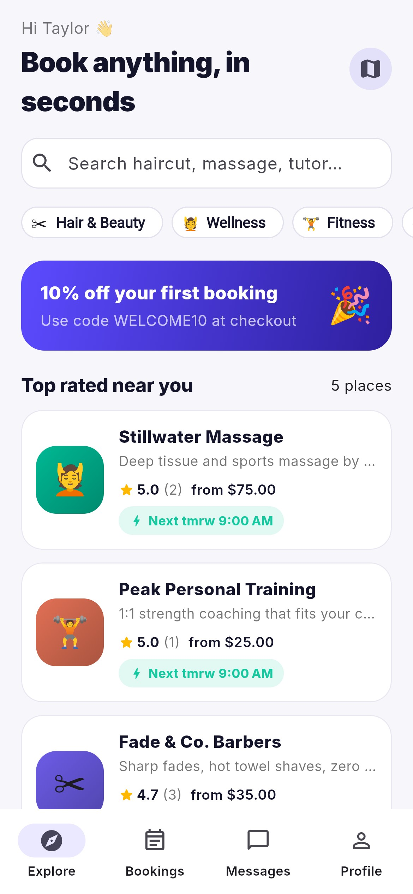
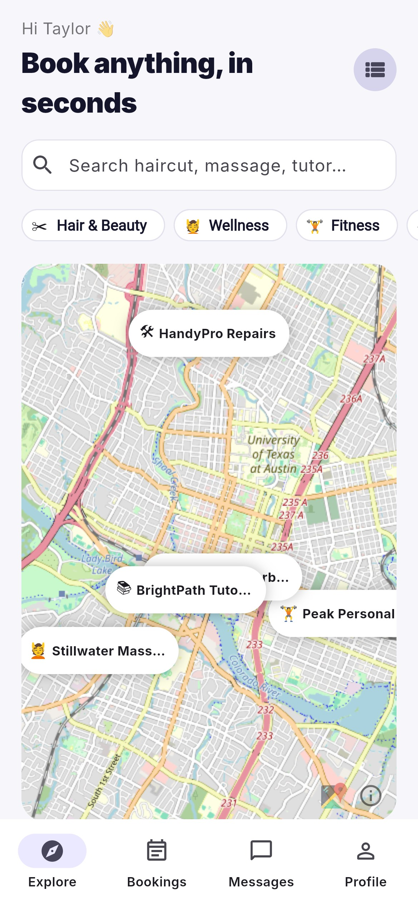
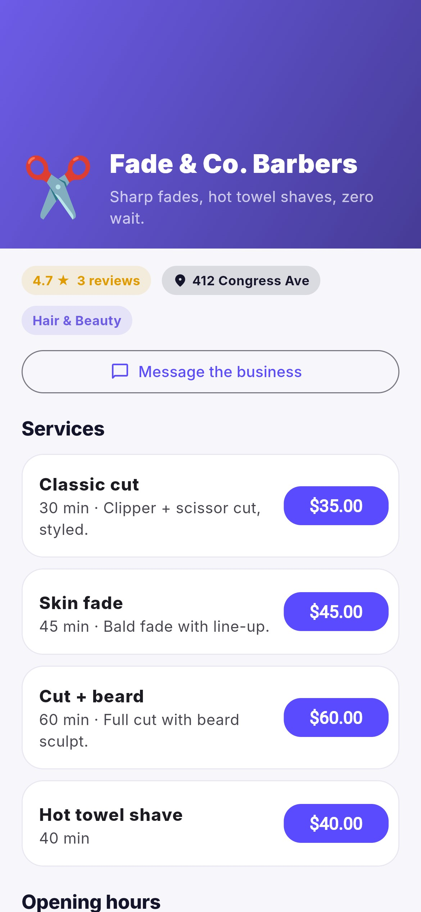
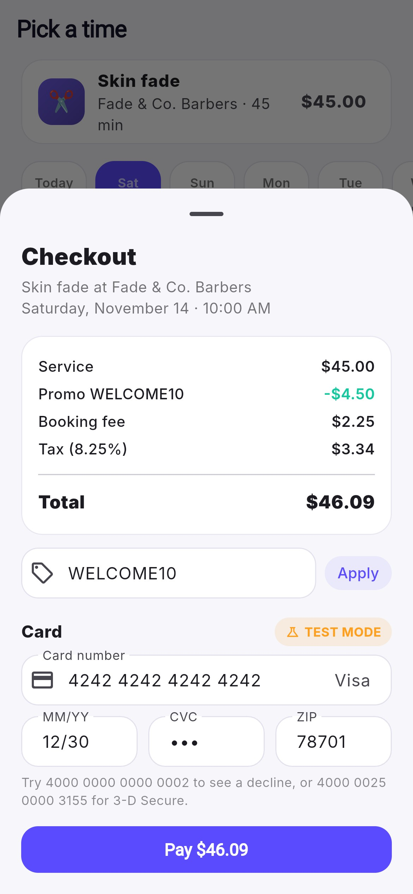
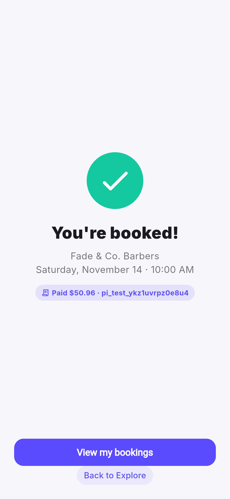
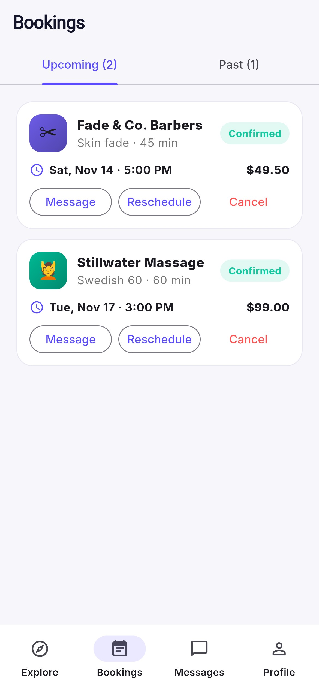
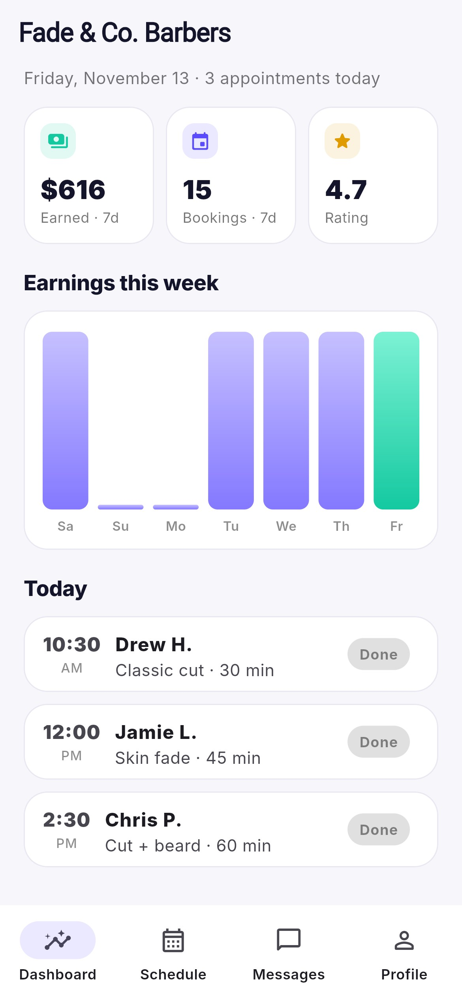
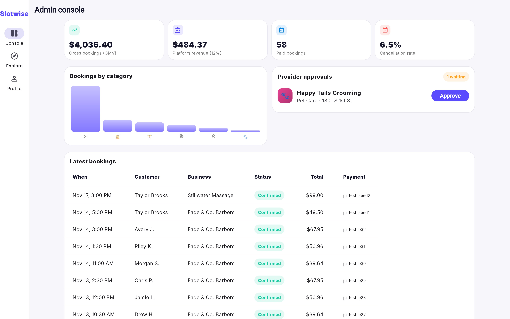

# Slotwise: booking & payments marketplace (Flutter + Firebase)

One **Flutter** codebase for Android, iPhone and the web. Customers find a local business, pick a free time slot and pay by card; providers run their day from a dashboard; admins run the marketplace from a web console. Real-time data on **Cloud Firestore**, **Stripe test-mode** payments, OpenStreetMap maps, in-app chat, and double-booking protection with Firestore transactions.

<p>
  
  
  
  
</p>
<p>
  
  
  
  
</p>


## Try it

| Platform | How |
| --- | --- |
| **Web (any browser)** | [neomaverick1.github.io/slotwise](https://neomaverick1.github.io/slotwise/) · open as [provider](https://neomaverick1.github.io/slotwise/#/?role=provider) · open as [admin](https://neomaverick1.github.io/slotwise/#/?role=admin) |
| **Android 7+** | Download `slotwise.apk` from the [latest release](https://github.com/neomaverick1/slotwise/releases/latest) and open it on your phone. |
| **iPhone simulator** | Download `Slotwise-ios-simulator.zip` from the same release, unzip, and drag `Runner.app` onto a booted simulator. |

Pay with Stripe's test card **4242 4242 4242 4242** (any future date, any CVC). Try **4000 0000 0000 0002** for a decline or **4000 0025 0000 3155** for 3-D Secure. Promo codes: `WELCOME10`, `SLOT20`. Nothing is ever charged.

Every push to `main` runs analysis and tests, builds the Android APK, the iOS simulator app and the web app, deploys the web app to GitHub Pages and publishes a release ([`.github/workflows/build.yml`](.github/workflows/build.yml)).

## Features

| Area | What it does |
| --- | --- |
| **Explore** | Search across businesses and services, category chips, rating sort, "next free slot" badges, and a map view (OpenStreetMap via `flutter_map`). |
| **Business page** | Service menu with prices and durations, opening hours, reviews, and a message button. |
| **Smart time slots** | Slots are generated from weekly opening hours, service length, a cleanup buffer between appointments, a 1-hour lead time and existing bookings. 14-day date strip, grouped into morning / afternoon / evening. |
| **Checkout** | Price breakdown (booking fee, 8.25% tax, promo codes), card form with Luhn, expiry and CVC checks and brand detection, Stripe test-card behaviour (success, decline, insufficient funds, 3-D Secure). Optional Stripe Checkout through a test-mode Payment Link. |
| **No double booking** | A slot is reserved before charging. On Firestore this runs in a **transaction** on a per-business-per-day lock document, so two people can't take the same time even at the same second. A failed payment releases the slot. |
| **My bookings** | Upcoming and past, reschedule (with the same availability rules), cancel with instant test refund, message the business. |
| **Chat** | Real-time threads between customer and business (Firestore listener; in demo mode the business replies automatically). |
| **Provider dashboard** | Earnings for the last 7 days with week-over-week change, booking count, rating, an animated earnings chart, today's schedule, and switching services on or off. |
| **Admin console (web)** | GMV, platform revenue (12% commission), paid bookings, cancellation rate, bookings by category, provider approvals, and the latest bookings with payment references. Responsive: navigation rail and wide layout on desktop. |
| **Roles** | Customer, provider and admin in one app; switch in Profile or deep-link with `#/?role=provider`. |

## Architecture

```
lib/
  data/        models, demo seed, MarketRepository (in-memory + Firestore implementations)
  domain/      availability (slot generation, overlap checks) and pricing (fees, tax, promos, payouts) - pure Dart, unit-tested
  payments/    PaymentGateway interface, Stripe test-mode gateway, card validation, Stripe Payment Link
  core/        Riverpod providers and theme
  features/    explore, business page, booking + checkout, bookings, chat, provider dashboard, admin console, profile
  widgets/     shared UI (charts, KPI cards, pills)
```

* **State:** Riverpod 3 (`Notifier`, `StreamProvider`, provider families). **Navigation:** go_router with deep links.
* **Backend switch:** the UI only talks to `MarketRepository`. Demo mode is in-memory and works offline; `--dart-define=BACKEND=firebase` switches to `FirestoreRepository` (real-time streams, transactions).
* **Money** is stored in integer cents everywhere.
* **Tests:** 30 tests: slot generation edge cases (buffers, closed days, lead time, cancelled bookings), pricing and rounding, Stripe test cards, card validation, repository double-booking and reschedule rules, and widget tests that book and pay end to end, see a declined card free the slot, and approve a provider as admin.

## Build it yourself

```bash
flutter pub get
flutter test
flutter run                      # demo mode, no keys needed
flutter build web --no-web-resources-cdn
```

Firestore (optional):

```bash
flutter run --dart-define=BACKEND=firebase \
  --dart-define=FIREBASE_API_KEY=... --dart-define=FIREBASE_APP_ID=... \
  --dart-define=FIREBASE_SENDER_ID=... --dart-define=FIREBASE_PROJECT_ID=...
```

Stripe Checkout (optional): create a Payment Link in the Stripe dashboard in **test mode** and pass `--dart-define=STRIPE_PAYMENT_LINK=https://buy.stripe.com/test_...`. The booking id goes along as `client_reference_id`.

## Stack

Flutter 3.50 · Dart 3 · Riverpod · go_router · Cloud Firestore · Stripe (test mode) · flutter_map / OpenStreetMap · intl · GitHub Actions · GitHub Pages

Map data © OpenStreetMap contributors. Inter font under the SIL Open Font License. MIT licensed.
